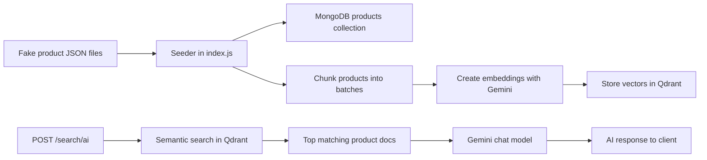

# LangChain + Qdrant RAG Product Search

This project is a small retrieval-augmented generation (RAG) backend for an e-commerce product catalog. It loads product data, stores it in MongoDB, creates vector embeddings in Qdrant, and uses Gemini to answer product-related search requests in natural language.

## What Happens Here

1. The server starts with Express.
2. Environment variables are loaded from `.env`.
3. MongoDB is used to store raw product records in a `products` collection.
4. Product text is converted into embeddings with Google Gemini embeddings.
5. Those embeddings are stored in Qdrant for semantic search.
6. When a user sends a search request, the app retrieves the most relevant products from Qdrant.
7. Gemini generates a final answer using only the retrieved context.

## Architecture



## Main Components

- `index.js` - Express server, MongoDB connection, vector search, and AI response logic.
- `chunkArray.js` - Splits product data into smaller batches before inserting and embedding.
- `fake_products.json` - Source data used for seeding.
- `fake_products_100k.json` - Larger product dataset for scaling or testing.

## Request Flow

### Product seeding

The `createProductIntoDB()` function reads `fake_products.json`, splits the array into batches of 50, inserts each batch into MongoDB, and sends the same product batch to Qdrant after converting each record into a document format.

### AI search

The `POST /search/ai` endpoint accepts a JSON body like:

```json
{
	"input": "show me cheap wireless headphones"
}
```

The server then:

- searches Qdrant with the user query,
- takes the top matching products,
- builds a short context window from those results,
- asks Gemini to answer using only that context,
- returns the AI response as JSON.

## API Endpoints

### `GET /`

Returns a simple health message confirming the server is running.

### `POST /search/ai`

Searches products semantically and returns a Gemini-generated answer.

Required body:

```json
{
	"input": "your search text"
}
```

## Environment Variables

Set these in your `.env` file:

- `PORT` - Server port, defaults to `4000`.
- `MONGODB_URI` - MongoDB connection string.
- `QDRANT_URL` - Qdrant server URL.
- `QDRANT_COLLECTION_NAME` - Optional Qdrant collection name, defaults to `store_agent`.
- `IP_ADDRESS` - Used in the startup log message.

## Notes

- The automatic seeding call is currently commented out in `app.listen()`, so data is not inserted unless you enable `createProductIntoDB()` manually.
- The AI prompt is strict: it tells Gemini to answer only from retrieved context.
- If Qdrant returns no matches, the API responds with a fallback message.

## Run

```bash
npm install
npm run dev
```

## Example Response

```json
{
	"ai": "- Product name: ...\n- Price: ...\n- Category: ..."
}
```
